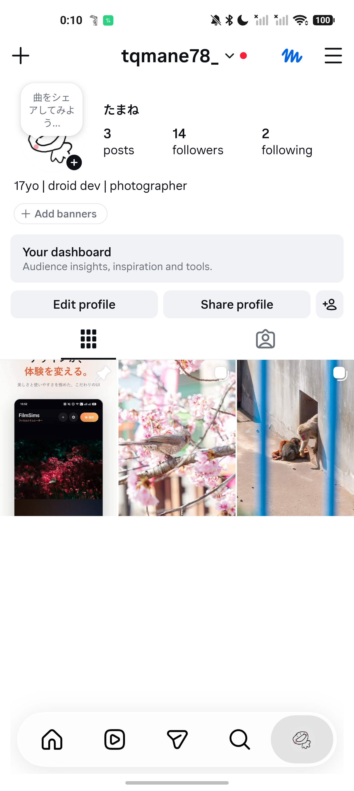
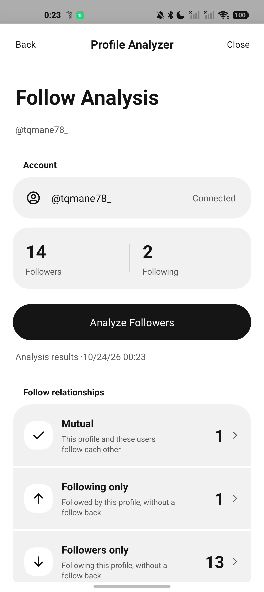
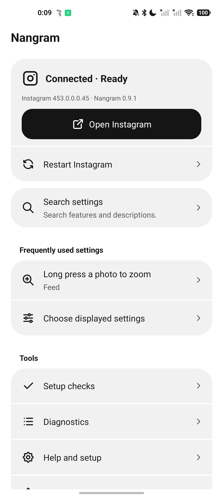

# Nangram Documentation (English)

Welcome to the official documentation for **Nangram**, an independent Android customization module and companion dashboard designed for Instagram.

> [!NOTE]
> Nangram is an independent project and is not affiliated with, sponsored by, or endorsed by Instagram or Meta.

---

## See Nangram in action

Real screenshots from the English interface, using **@tqmane78_**.

### Liquid Glass navigation

A floating glass bottom bar with Instagram’s familiar icons and actions. Enable it in Nangram’s interface settings for a translucent, monochrome look.

### Profile Analyzer

See mutual follows, accounts that do not follow you back, and followers you do not follow. Compare saved snapshots on your device to track changes over time, without entering your password again. Your first completed scan becomes the baseline for later comparisons.

### A companion that stays in sync

Find settings quickly and keep up to six shortcuts on your Nangram home screen. Supported settings sync both ways with Instagram for the active account and settings profile while the apps are running; some changes need an Instagram restart.

Folder permissions, lock credentials, saved media, and history are not copied between the apps. Profile Analyzer compares fetched lists; it does not identify profile visitors or prove that someone blocked you.

## Quick Navigation

* **Documentation**: [English User Guide](GUIDE.md)
* **Japanese / 日本語**: [日本語 README](../jp/README.md) | [日本語ユーザーガイド](../jp/GUIDE.md)
* **Official Releases**: [GitHub Releases](https://github.com/tqmane/nangram/releases) *(downloads are available here only when published by the maintainer; check release notes for verified compatibility)*
* **Support Community**: [Discord Server](https://discord.gg/zJBrCaf6dz)

---

## Overview

Nangram consists of two components:
1. **Instagram Module**: Works within the Instagram app to provide interface settings, privacy controls, and media saving options.
2. **Companion Application**: A standalone dashboard opened from your app drawer to search settings, manage quick shortcuts, check connection status, and view help. (Media downloads, message history, and backup tools are managed within Nangram settings inside Instagram.)

This repository contains user documentation only; application source code is private.

### Key Capabilities

When supported features are enabled:

* **Feed & Interactions**: Filter feed posts, copy captions and comments, zoom photos, and enable confirmation prompts before liking or following.
* **Story Controls & Archiving**: Control story playback, browse stories without sending seen status on supported screens, and save your own posted stories and viewer lists while active.
* **Direct Messages & History**: View incoming messages without sending read receipts, send receipts manually on demand, keep a local history of seen messages, and protect screens with local app locks.
* **Media Downloads & Library**: Save posts, reels, or stories to chosen folders, track downloads in a queue, save media from profiles in batches by count, and organize saved files in an offline library.
* **Profile Watchlists**: Check for profile updates (such as bio, avatar, or follower count) while Instagram is open in the foreground.
* **Appearance & Profiles**: Customize themes and switch configuration profiles for different accounts.

---

## Environment & Compatibility

* **Framework Requirement**: Requires an environment supporting **libxposed API 102** as a necessary setup requirement.
* **Supported Instagram version**: `453.0.0.0.45`. Check the release notes for updates.
* **Patch-Embedded Managers**: If using an environment that patches the module directly into an APK, re-patch and re-sign after updates according to your manager's workflow. Not all patch managers are supported.
* **Signing Keys & Data**: Updates require APKs signed with the same signing key. Local data belongs to each app separately: uninstalling Nangram removes its own companion data, and uninstalling Instagram removes data stored in Instagram. Always back up important data and check your signing key before any uninstallation; do not casually uninstall either app.

---

## Getting Started

To install, configure, and troubleshoot Nangram, please proceed to the [English User Guide](GUIDE.md).
